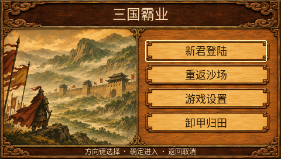
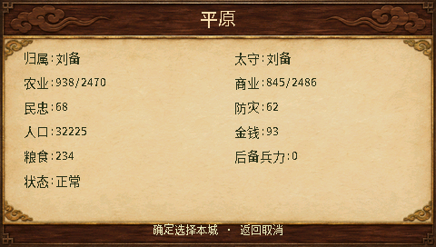
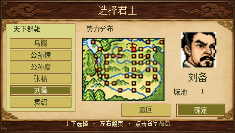
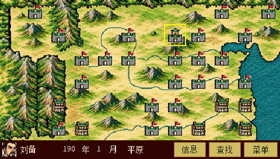
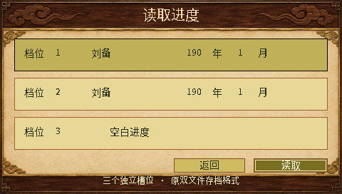

# BBKH1-sango · 三国霸业 H1 横屏版

> 工作区开发候选：**0.2.3-h1-ui**，小窗菜单配合文泉驿 / Terminus 原生点阵字库。已通过离线 MIPS 检查，尚未进行本候选真机验证或发布；详见 [点阵候选记录](reports/H1-BITMAP-CANDIDATE.md)。下文发布版本记录仍为 0.2.2。

将 [HelloClyde/BBK9588-sango](https://github.com/HelloClyde/BBK9588-sango) 的 C 重建版移植到 **步步高 H1 / Y100 V1.41，480×272 横屏**。当前版本 **0.2.2-h1-savepath** 为预览版，未完成整场战斗与完整战役验收。

原游戏恢复代码和派生素材未提供开放许可证；本仓库公开源码用于研究，不将整仓宣称为 MIT 授权。新增适配、音频、字库和 SDK 的许可分别见 [LICENSE.md](LICENSE.md) 与 [来源声明](THIRD_PARTY_NOTICES.md)。

## 快速开始

从本仓库 [Releases](https://github.com/HelloClyde/BBKH1-sango/releases) 下载同一版本的 **H1Sango-install.zip**。将 ZIP 中的“应用”目录合并至设备内置存储根目录，保留以下结构：

```text
应用/程序/H1Sango.bda
应用/数据/游戏/sango.lib
应用/数据/游戏/sango.clr
应用/数据/游戏/sango.h1r
应用/数据/游戏/SGMUSIC/menu.wav
应用/数据/游戏/SGMUSIC/strategy.wav
应用/数据/游戏/SGMUSIC/battle.wav
```

退出 USB 磁盘模式后，从桌面游戏分类打开《三国霸业》。程序与素材须一起更新。个人存档为 `A:\应用\数据\游戏\sango0.sav` 至 `sango5.sav`，安装包不覆盖存档；设置在资源目录的 `sango.cfg`。不包含固件、NAND、原机 BDA、工具链或个人存档。

方向键移动 / 选择，确定执行，返回取消；也可触摸菜单、君主、城池及按钮。战略地图支持拖动。主菜单沿用原文“新君登陆”。

开发者在 Windows PowerShell、Python 3.12 下执行：

```powershell
git clone https://github.com/HelloClyde/BBKH1-sango.git
cd BBKH1-sango
git submodule update --init sdk
python -m pip install -r requirements-h1.txt
python tools/install_h1_toolchain.py
python h1/build_h1.py --assets
python tools/verify_h1_release.py
python h1/test_landscape.py
python h1/check_uniform_footer.py
python h1/test_save_paths.py
```

成品输出在 `dist/h1/`。安装脚本校验 GNU 15.2.0 工具链 ZIP 的 SHA256；已有工具链可用 `--cc PATH/TO/mipsel-none-elf-gcc.exe` 或 `H1_GNU_BIN` 指向其 bin 目录。`H1_SDK` 可覆盖 SDK 路径，正式发布固定为子模块提交。

仓库已包含字形表及横屏面板，普通构建无需图像生成服务。当前候选用 `python h1/make_font.py` 与 `python h1/prepare_landscape.py` 从 `assets/fonts/bitmap/` 的文泉驿 / Terminus 原生 BDF 重新编码和排字；各自许可见 LICENSE.md。`build.py`、[README-9588.md](README-9588.md) 和原有 `tools/test_*.py` 保留上游 9588 工程历史，H1 入口以本页为准。

从 0.2.1 升级时，先备份旧 `A:\H1SANGO\` 中的存档，再按原名成对移入上述游戏目录；新版只读取新目录，不自动移动旧文件。详见[升级说明](releases/v0.2.2-h1-savepath.md)。

## 截图

以下为 0.2.1 横屏与字体版在物理 H1 上经 H1Debug 获取的 **480×272 原尺寸截图**：

| 主菜单 | 城池信息 |
| --- | --- |
|  |  |
| 君主选择 | 战略地图 |
|  |  |

开发候选底栏为原生 12px 点阵，正文 / 按钮为原生 14px 点阵，标题 24px（2×12px）；所有汉字统一字号和基线，不逐字缩小。横屏素材重新布局，战略地图显示 12×6 格，战场绘制视口为 20×9 格。

## 依赖

使用成品只需要 H1 / Y100 V1.41 和同版资源文件，无需安装 SDK、H1Debug 或电脑软件。

构建依赖：

- [MrDefinition1999/bbk-h1-bda-sdk](https://github.com/MrDefinition1999/bbk-h1-bda-sdk)，固定 `067fe072477861dfc8949d7b1a55279fb92d2548`，位于 `sdk/`。这是 H1 专用 SDK，未套用 9588 固件 ABI。
- Windows GNU MIPS little-endian 15.2.0，安装入口 `tools/install_h1_toolchain.py`；其他平台需自行提供兼容编译器，不宣称已验证跨工具链一致性。
- Python 3.12、Pillow 12.3.0、pyelftools 0.33；离线 MIPS 检查另需 Unicorn 2.1.4，见 `requirements-h1.txt`。
- 字库和原尺寸图像已纳入源码，无需原版 BDA / LIB、固件或私人模拟器即可构建。

## 验证与限制

横屏与字体版于 2026-11-17 在物理 H1 上安装并校验完整程序和六个资源文件，通过设置触控、剧本 / 君主选择、方向键地图移动、数量 0→1 与取消、三槽界面中的第一槽存读档和正常退出。重载恢复全部 200 名武将数据；城池底栏像素与已验证的固件截图一致。

0.2.2 的存档目录修正在物理 H1 上通过旧档迁移、原档保持不变、新档保存与重载、正常退出检查。下图为本版在新目录写入第二槽后的真机画面：



当前存档路径修正版的确切 BDA SHA256：`63517c7a45794d24ecc598ee405929e87e856e1202925370dac3e21ede48bc5c`。见 [验证记录](reports/H1-VERIFICATION.md) 和 [存档路径真机结果](reports/hardware-savepath-20261117/physical-checks.json)。发布校验会将构建产物与真机证据逐文件比较，不能用另一份 BDA 的测试代替。

Actions 从固定 SDK 和源码构建、校验 BDA / ZIP、运行固件服务被建模的 MIPS 检查；它不执行物理 H1 或完整固件模拟器。已通过的同指纹真机证据直接复用。整场战斗、全部指令、完整战役及真机听音未完成；离线战场截图不标为真机战斗证明。

## 感谢

- 上游 [HelloClyde/BBK9588-sango](https://github.com/HelloClyde/BBK9588-sango)，本移植基于 `8786793bd9c7c102b05b72cd9d88887d100ac60d`，保留恢复代码、彩色素材及原提交历史。
- 原游戏制作群组：策划 **BBK gamegroup**；程序 **通宵虫、南方小鬼**；美工 **Sunday**。
- **HelloClyde / BBK9588-bda-sdk** 提供的原重建版本、SDK 工具与修复工作；**MrDefinition1999 / bbk-h1-bda-sdk** 提供 H1 原生 SDK。
- 提供原文件、9588 真机反馈、9288S 对照及 H1 适配需求的使用者。
- 原图参考、GPT Image 生成素材及音乐来源记录保留在 `assets/`；Noto 字体来自 Noto CJK 项目。

致谢不替代原游戏、素材、音乐或字体的许可。
