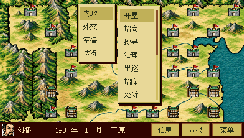
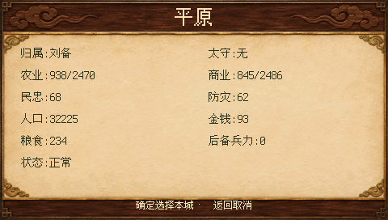
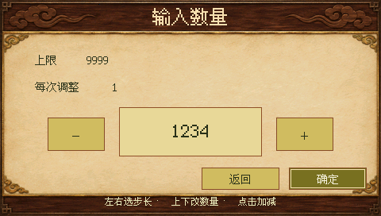

# 0.2.3 H1 UI 候选：原生点阵字体

2026-11-18。本地开发候选 `0.2.3-h1-ui`，合并上一阶段的小窗菜单。尚未做本候选真机验证，未推送、未发布；已发布版本仍为 0.2.2。

## 改动

中文改用文泉驿点阵宋体的原生 12 / 14 / 16px BDF，ASCII / 数字用 Terminus 的原生等宽 6×12 / 7×14 / 8×16 BDF。正文 14px、提示 12px；标题 24px 是 12px 点阵的 2 倍整数放大。主菜单及剧本页的图片文字也已重新排字。当前字体生成及排字不调用 Noto 矢量栅格化，没有抗锯齿、非整数缩放或逐字缩小。

源包经 Debian HTTPS 的 DSC SHA256 清单核对，原始 BDF 与许可正文随源码保存，见 assets/fonts/bitmap/manifest.json、LICENSE.md 和 THIRD_PARTY_NOTICES.md。

7573 个 GBK 字符的四档字形共 30292 项检查通过，逐字确认源笔画像素完整保留。小尺寸源字库缺失的少数罗马数字用原生字母像素组合，两枚 14px IPA 字符使用 12px 无缩放字形；14px“苯”的负左边距向右平移一像素。上述例外记录于 font-validation.json，没有缺字占位或裁笔画。

## 产物

- BDA：2488384 字节，SHA256 `8431c0698cf73e0011c7155f5065b39094880f625e9edc128f919e8acb5234b4`。
- sango.h1r：1620580 字节，SHA256 `56d6d25156596277e10fd72ac0b33274cbd245b8a92a48baf00ef1ca96a39a40`。新版 BDA 与 H1R 须一同更新。
- SDK 仍固定 `067fe072477861dfc8949d7b1a55279fb92d2548`。GNU MIPS 15.2.0，目标 H1 / Y100 V1.41，480×272。

## 验证

- make_font.py：30292 项原始像素完整性检查。
- test_bitmap_font.py：编译后字库的 60 个字形样本与源像素一致；7573 个 24px 字形全部与 12px 字形的最近邻 2 倍整数放大逐像素相同。实际 MIPS 主菜单、设置 / 百分号、数字输入 1234 页面绘制通过。
- test_popup.py：20 项弹窗、父子菜单、选择 / 取消、底图恢复、边缘、滚动和内存失败检查通过。
- test_landscape.py：32 项后端与 507 项视口检查通过。
- test_save_paths.py：40 项存档路径检查通过，仍使用应用数据游戏目录。
- check_uniform_footer.py：新 BDA 的城池页与 12px 提示渲染通过。

以上为实际编译后 MIPS 与源像素验证；堆、显示、输入等固件服务被建模，不冒充完整固件或物理 H1 验证。既有真机记录保留各自历史 BDA 指纹。

下一步待 H1Debug 可连接后，同时上传 BDA 与 H1R，实机查看菜单、底栏、标题及数字，验证开闭小窗和正常退出。当前发布校验仍绑定 0.2.2 的真机证据，不将本候选标记为已通过发布门槛。
