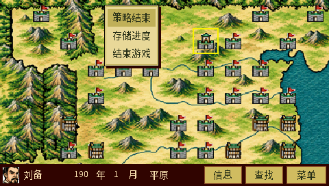
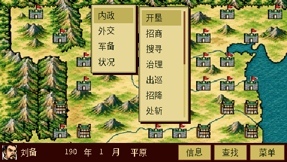

# 0.2.3 弹出菜单候选

2026-11-18。当前为本地开发候选，尚未上传物理 H1，也未推送或发布新版本。

- BDA：3124544 字节，SHA256 `948be8e81f5c369c68c2db4eb2a143bbbf14d843e6c3cf80fcc748b2a8291250`。
- SDK：`067fe072477861dfc8949d7b1a55279fb92d2548`；GNU MIPS 15.2.0。素材及字库未改。
- `h1/native_ui.c` 的通用指令和物品菜单改为小窗，按文字宽度及选项数收紧，最多显示七行并提供滚动条。沿用原菜单锚点，地图 / HUD 不清屏、不变暗。
- 城池命令继续调用原控制器逻辑；在 H1 UI 外层管理父菜单快照，使内政、外交和军备子菜单在父菜单右侧展开。选择 / 返回码保持原版。
- ESC 或点击窗外取消，恢复原画面；战斗背景先合成最新帧，显示菜单期间避免被战场重绘覆盖；快照分配失败时直接取消。

## 已通过

`python h1/test_popup.py`：20 项实际编译后 MIPS 检查，覆盖小窗像素边界、地图 / HUD 保持、键盘及触控选择、滚动、空菜单、初始值、原命令映射、父子菜单及逐级取消、40 项长中文条目与边缘限制、物品索引、战斗模式恢复、快照失败与释放。原生堆、输入和显示服务被建模；不是物理 H1 证明。

同一 BDA 另通过 `h1/test_landscape.py` 的 32 项后端及 507 项战场视口检查、`h1/test_save_paths.py` 的 40 项路径检查和 `h1/check_uniform_footer.py` 的字体页面检查。相关 JSON 保留确切 BDA 指纹。

## 待完成

本次 ESP USB2 仍枚举为 COM6，但 H1Debug 打开桥接返回 `H1DBG/1 ERROR queue`；只读 INFO 为 `usb_connected=false`、`usb_cdc_stage=cdc_open`、`usb_last_error=ESP_ERR_NOT_FOUND`。没有向设备写入或模拟输入。已提示用户打开 H1Debug，未重复重试不变的接口。

待连接后核对 H1Debug 身份和当前界面，正常退出前台再上传完整 BDA，验证真实系统菜单、父子菜单触控 / 返回 / 点击窗外、底图恢复及正常退出。保留已有存档，不写测试档即可完成本轮 UI 检查。之后补充新 BDA 的物理证据，再更新发布校验引用并做干净构建 / CI / 新标签发布。当前 `verify_h1_release.py` 仍绑定已发布 0.2.2 的真机证据，不能据此宣称本候选已通过发布门槛。
